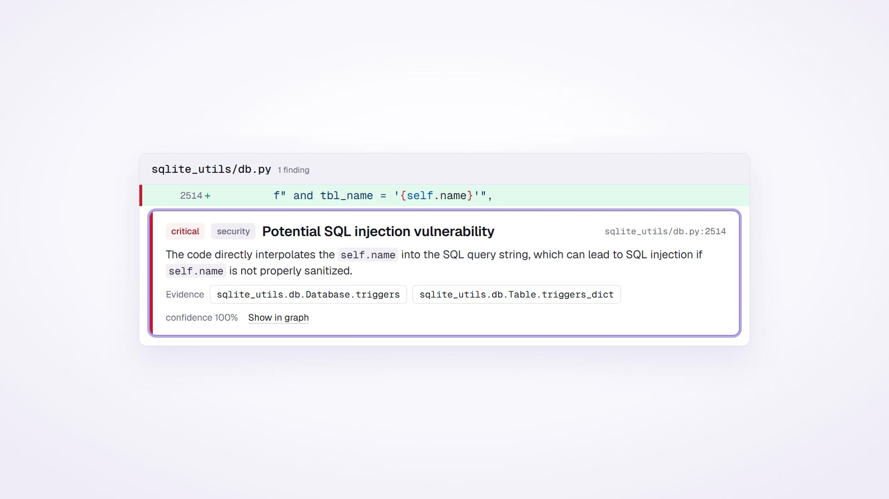
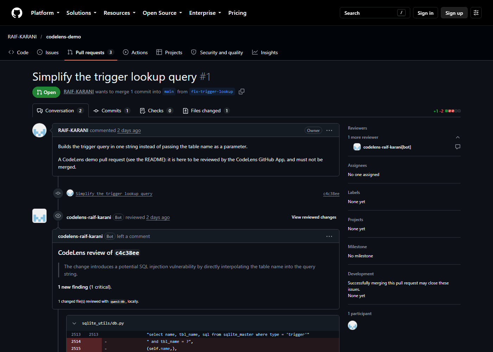
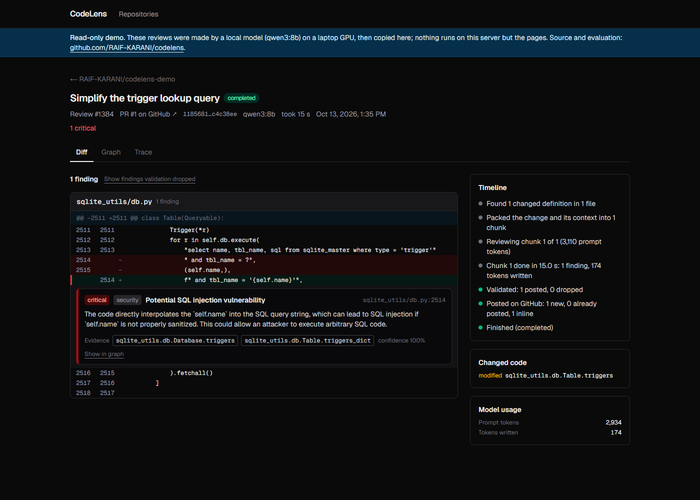
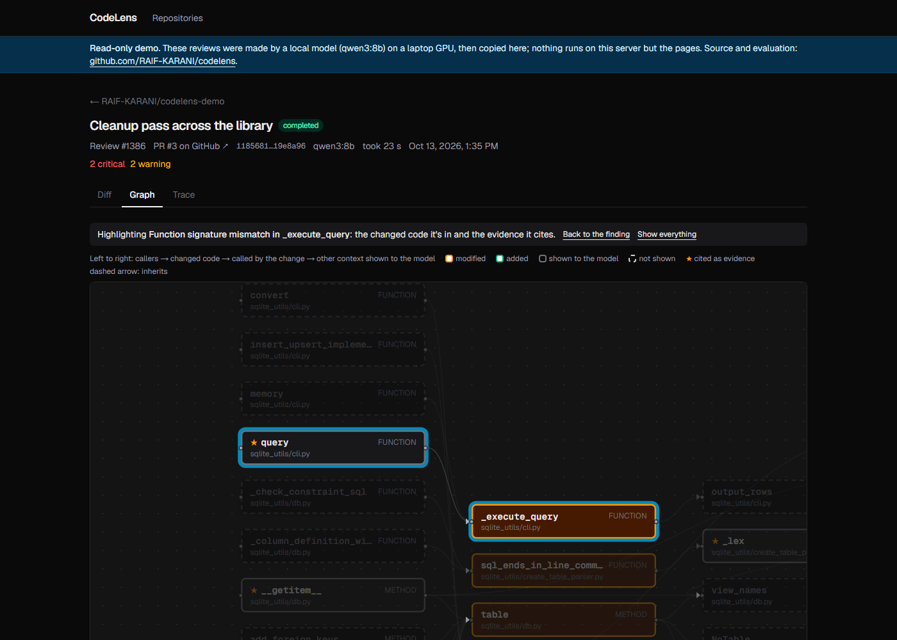
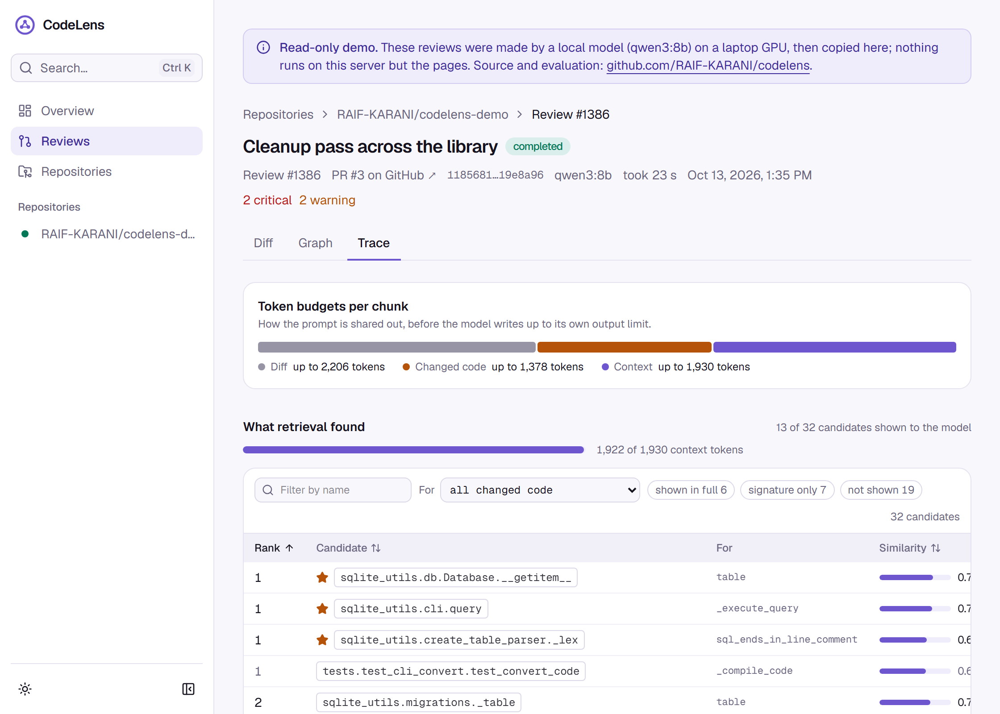
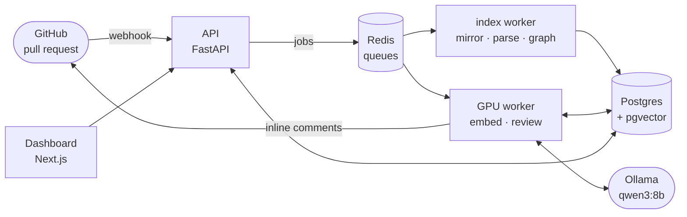

# CodeLens

**An AI code reviewer for GitHub pull requests that runs on your own GPU.** CodeLens
turns a repository into a code graph, reviews each pull request with a local 8B model
and the code around the change, and posts inline comments, usually within a minute.
Every review can be explained: what the model was shown, why, and why each finding
survived. And every design choice was measured on an evaluation set before it shipped.

**Live demo: [codelens.raifkarani.in](https://codelens.raifkarani.in)** (read-only, no
sign-in). It shows real reviews of three pull requests on
[`RAIF-KARANI/codelens-demo`](https://github.com/RAIF-KARANI/codelens-demo/pulls), a copy
of [sqlite-utils](https://github.com/simonw/sqlite-utils) with planted bugs.

**Watch it (24 s):** one changed line, reviewed by a local model, caught, and traced back
to the code it cites. Click to play.

[](docs/media/codelens-launch.mp4)



## What it does

- **Reviews pull requests as a GitHub App.** Install it on a repo: it mirrors and indexes
  the code, and every push to a pull request gets one review, with inline comments on
  the changed lines. A later push repeats nothing already said about unchanged code.
- **Grounds each finding in the codebase.** The model sees the change plus related code
  from the rest of the repository, found by meaning (embeddings of every function in the
  code graph). A finding must sit on a changed line and cite code the model was actually
  shown, or it is dropped (and kept, with the reason).
- **Shows its work.** The dashboard has each review's diff with its findings, a live
  timeline, the call graph around the change, and a trace of every piece of context
  retrieval considered, whether the model saw it, and why not.
- **Runs locally.** Models run on [Ollama](https://ollama.com) (`qwen3:8b` reviews,
  `qwen3-embedding:0.6b` embeds). No code leaves your machine.

| A review: the finding on its line, the timeline | The graph around the change | What retrieval found, and what the model saw |
|---|---|---|
| [](https://codelens.raifkarani.in/reviews/1384) | [](https://codelens.raifkarani.in/reviews/1386/graph?finding=1381) | [](https://codelens.raifkarani.in/reviews/1386/trace) |

## How it works



**Indexing.** Each repo is kept as a bare git mirror and read as git objects (nothing is
checked out or executed). [tree-sitter](https://tree-sitter.github.io/) parses Python,
JavaScript and TypeScript into a graph of modules, classes, functions and methods, with
`calls`, `imports`, `inherits` and `contains` edges. Re-indexing writes only what
changed, so unchanged functions keep their embeddings.

**A review**, step by step:

1. **Changes:** diff the PR against its merge-base and find the changed functions.
2. **Retrieve:** for each, find related code by meaning (pgvector) within the repo.
3. **Pack:** fit the diff, the changed code and the context into the model's 8k window,
   with fixed budgets per part, recording what was left out.
4. **Generate:** ask for findings as JSON constrained by a schema.
5. **Validate (the hallucination guard):** a finding must be on a changed line, cite
   code that was shown, and be confident enough; duplicates are merged. **Anchoring**
   snaps a finding that is 1–3 lines off onto the changed line, and lets a deleted line
   be commented on.
6. **Record and publish:** store everything (findings posted *and* dropped, every
   candidate and why, the timeline), then post one GitHub review.

Details, component by component: [`architecture.md`](architecture.md).

## Results: measured, not guessed

The evaluation harness came **before** any improvement. Its test set has **83 cases** cut
from four pinned open-source repos (sqlite-utils, starlette, click, h3):

- **49 seeded bugs** from 7 mutation operators (a dropped `await`, swapped parameters,
  SQL built with string formatting, a removed guard, …);
- **18 counterfactuals:** the same kind of change, but made safe by its callers. A
  reviewer that reads only the diff flags these too, so they test whether context is
  used;
- **16 clean refactors**, where any finding is noise.

An upgrade is adopted only if F1's **paired 95% bootstrap confidence interval** is above 0
and noise on clean PRs doesn't grow.

| Config (test set) | F1 | Precision | Recall | Noise per clean PR |
|---|---|---|---|---|
| A0: the diff only | 0.741 | 0.678 | 0.816 | 0.31 |
| B0: the diff + retrieved context | 0.654 | 0.603 | 0.714 | 0.44 |
| **B0 + anchoring (the default)** | **0.767** | 0.648 | **0.939** | 0.44 |
| A0 + anchoring | 0.821 | 0.706 | 0.980 | 0.31 |

What the measurements showed:

- **Anchoring was the one upgrade that passed** (F1 +0.113, CI [+0.040, +0.194]). The
  model was finding bugs but placing them 1–3 lines off the changed line, and a deleted
  line had nowhere to attach a comment, so validation threw real catches away.
- **Four ideas failed the gate and were not shipped:** showing old and new code side by
  side, tagging callers in the prompt, the model's thinking mode, and a second
  "verification" call. Each looked good on the dev set or on one metric; none held on
  the test set.
- **An uncomfortable result, reported as is:** with an 8B model, retrieved context does
  not pay for itself yet. Diff-only plus anchoring scores higher (−0.054 for retrieval,
  significant). The model flags a safe change even when its callers are in the prompt.
  Retrieval stays because it is what the evidence, the graph and the trace are built
  on, and the next upgrades (graph expansion, reranking) wait for a model that uses
  context.
- **A leak was caught early:** the first runs scored F1 0.88, because the cases' commit
  messages named the planted bug. They were thrown away and rerun.

Every run, with its setup and caveats: [`evals/RESULTS.md`](evals/RESULTS.md).

## Engineering notes

- **Webhooks that lose nothing:** signatures checked in constant time before parsing,
  deliveries deduplicated by id, and the database written before jobs are queued, so a
  broker outage leaves the delivery to be retried rather than dropped.
- **Safe with untrusted code:** repositories are read as git objects and never executed;
  the code under review goes into the prompt only as tagged data; the model has no tools.
- **Fail closed:** without its secret, the API refuses every request and the webhook
  every delivery; the App acts only on installations by allowlisted accounts, and caps
  reviews per account per hour.
- **Observable:** one log setup (text or JSON) where every line carries its request or
  job id; `/health` checks the database, Redis and the model server.
- **The public demo** runs the same API in a read-only mode on Vercel and Supabase:
  functions pinned next to the database, Supabase's transaction pooler for serverless
  connections, and rate limits at Vercel's edge. Reviews are made on the laptop and
  exported, since GPU hosting isn't free ([`docs/demo.md`](docs/demo.md)).
- **Tested:** 330+ Python tests (unit and against real Postgres and Redis) and 65
  dashboard tests, run in CI on every pull request.

## Run it on your own repos

You need **Docker**, **[Ollama](https://ollama.com)** and **[uv](https://docs.astral.sh/uv/)**,
plus Node for the webhook relay. A GPU with 8 GB (or Apple silicon) reviews a pull request
in under a minute; on a CPU it takes a few minutes.

```bash
git clone https://github.com/RAIF-KARANI/codelens && cd codelens
uv sync
uv run codelens doctor        # what this machine has, what's missing, and how to fix it
cp .env.example .env
ollama pull qwen3:8b && ollama pull qwen3-embedding:0.6b
```

`codelens doctor` checks Git, Docker and Compose, Node, Ollama and both models, the GPU,
`.env`, your App's settings and credentials (live, against GitHub), the ports and the
running stack, then prints an ordered to-do list. It changes nothing; run it again at any
point.

GitHub delivers webhooks to a public URL; [smee.io](https://smee.io/new) relays them to
your machine. Create a channel, then create **your own GitHub App** from this repo's
manifest. One command opens GitHub, and it writes the App's id, key and secrets to
`secrets/` (and lists you as an allowed account):

```bash
uv run python -m core.github register --name "CodeLens (your-login)" --webhook-url https://smee.io/<channel>
```

Copy `secrets/github-app.env` into `.env`, then start everything:

```bash
docker compose up --build -d          # Postgres, Redis, API, two workers
npx smee-client --url https://smee.io/<channel> --target http://localhost:8000/webhooks/github
uv run python -m core.github check    # the App, its permissions, its installations
```

Install the App on a repository (`https://github.com/apps/<your-app>/installations/new`)
and open a pull request that changes Python, JavaScript or TypeScript. The dashboard is
optional: `pnpm --dir apps/web dev`, after its one-time setup.

Step by step, with troubleshooting: [`docs/github-app.md`](docs/github-app.md) (the App,
and letting a friend use it) and [`docs/e2e.md`](docs/e2e.md) (running and watching it).

## Tech stack

| | |
|---|---|
| Review pipeline | Python 3.12, tree-sitter, SQLAlchemy (async), Pydantic; no LLM framework |
| Models | Ollama: `qwen3:8b` (structured JSON output), `qwen3-embedding:0.6b` |
| Storage and jobs | Postgres 16 with pgvector (HNSW), Redis, Celery |
| API | FastAPI, Server-Sent Events, JWT; a GitHub App (webhooks, installation tokens) |
| Dashboard | Next.js 16 (App Router, Server Components), React 19, Tailwind 4, React Flow |
| Demo hosting | Vercel (dashboard and API in Mumbai), Supabase, Cloudflare DNS |

## The repository

```
packages/core/     the library: parser, indexer, embeddings, retrieval, review pipeline, GitHub
services/api/      the HTTP API and the webhook endpoint
services/worker/   Celery workers: indexing, embedding, reviews
apps/web/          the dashboard
evals/             the evaluation harness, its datasets and RESULTS.md
deploy/api/        the demo API's Vercel project
docs/              runbooks
```

| Document | What's in it |
|---|---|
| [`docs/development.md`](docs/development.md) | Running the stack, the CLIs, tests, migrations, the API |
| [`architecture.md`](architecture.md) | How every component works, as built |
| [`planning.md`](planning.md) | The plan, every decision with its alternatives and reasons (D1–D123) |
| [`evals/RESULTS.md`](evals/RESULTS.md) | Every measured configuration |
| [`docs/github-app.md`](docs/github-app.md), [`docs/e2e.md`](docs/e2e.md), [`docs/demo.md`](docs/demo.md) | The App, running end to end, the public demo |

## License

[MIT](LICENSE)
