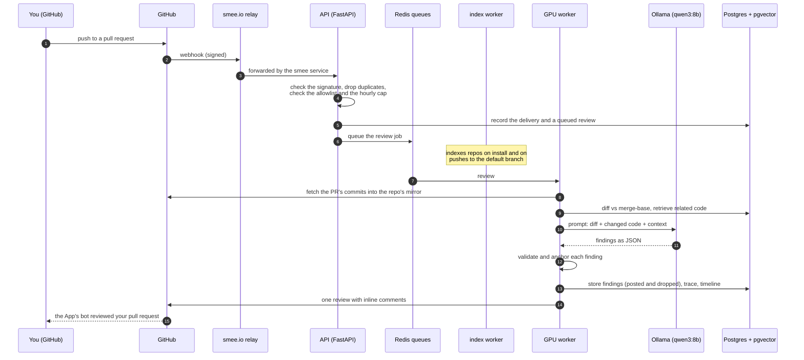
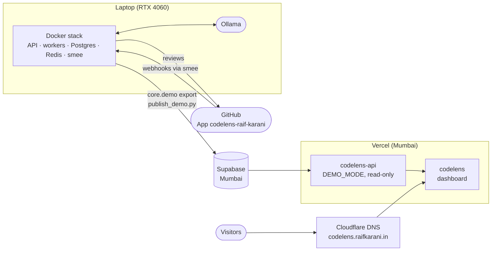
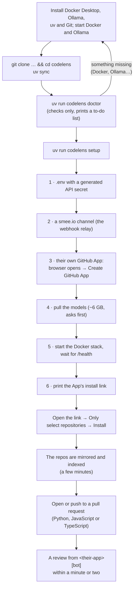

# How CodeLens flows

CodeLens is used in two ways:

- **The owner's side** (Raif): one laptop with the GPU reviews pull requests and feeds the
  public demo at [codelens.raifkarani.in](https://codelens.raifkarani.in).
- **Anyone else's side:** someone clones the repo and runs **their own** CodeLens, with
  **their own** GitHub App, on their own machine. Nothing they do touches the owner's laptop,
  App or demo.

Both sides run the same review engine, described first.

## The engine: from a push to a review



What each GitHub event does:

| GitHub event | What CodeLens does |
|---|---|
| The App is **installed** on repos | Mirrors each repo (a bare git copy) and indexes it: parse, code graph, embeddings |
| Repos **added** to the installation | Indexes the added ones |
| A **push to the default branch** | Re-indexes that repo (only what changed) |
| A pull request **opened, pushed to, reopened or marked ready** | Reviews it (an older queued review of the same PR is superseded) |
| The App is **uninstalled** | Forgets the installation; the repos' data stays |

Events from accounts not in `GITHUB_ALLOWED_ACCOUNTS`, and reviews past
`GITHUB_REVIEWS_PER_HOUR` (10) for one account, are ignored.

---

## Side 1: the owner (Raif)

The owner has three flows: reviewing on the laptop, publishing the demo, and changing the
code.



### 1. Review pull requests on the laptop

1. Start **Docker Desktop** and **Ollama**. Close games: they share the GPU and make reviews
   time out.
2. `uv run codelens setup`: it only does what's missing, so here it just starts the stack
   (with the relay) and waits until it's healthy.
3. `uv run codelens doctor` if anything looks off.
4. Open or push to a pull request on any repo the App is installed on. The review appears in
   15–40 s.
5. Optional: the local dashboard, `pnpm --dir apps/web dev` → http://localhost:3000, signed in
   with GitHub. It shows every review, its diff, the graph and the retrieval trace.
6. Watch a review: `docker compose logs -f worker-gpu`. Stop it all:
   `docker compose --profile relay stop`.

### 2. Publish the demo

The hosted demo has no GPU and no model: reviews are made on the laptop and copied up.

1. **Review** on the laptop: push to a pull request on the **public**
   [`codelens-demo`](https://github.com/RAIF-KARANI/codelens-demo) repo (keep PRs #1–#3 open:
   the demo and the README link them).
2. **Publish:** `python scripts/publish_demo.py`. It exports the demo repo's rows to
   `data/demo/codelens-demo.json.gz` (refusing any private repo), migrates the Supabase
   database and imports them, replacing the old copy. It reads `DEMO_DATABASE_URL` from
   `.env.demo` (never committed).
3. **Nothing to redeploy:** the hosted API reads Supabase on every request, so the demo
   shows the new reviews at once.
4. **Check:** open https://codelens.raifkarani.in and the new review.

A visitor's request: Cloudflare DNS → the `codelens` dashboard on Vercel (rate-limited to
100 requests a minute per IP) → the `codelens-api` function (rejects calls without the
dashboard's token) → Supabase through the transaction pooler. Visitors can read, never write.

Details: [`demo.md`](demo.md).

### 3. Change the code

1. A branch from an up-to-date `main`, then the checks: `ruff check`, `ruff format --check`,
   `pytest` (needs the Docker Postgres and Redis), and for the dashboard `pnpm lint`,
   `pnpm test`, `pnpm build`.
2. A pull request: CI runs the `python` and `web` jobs, and Vercel builds a preview of both
   projects.
3. Merge to `main`: Vercel deploys both projects to production by itself. The laptop picks
   up changes with `docker compose up --build -d`.
4. A schema change (a new migration) also needs `python scripts/publish_demo.py`, so the
   demo's database gets the same migrations.

Details: [`development.md`](development.md).

### Letting a friend use the owner's App (optional)

Instead of running their own, a friend can install the owner's App and have the laptop
review their repos: add their login to `GITHUB_ALLOWED_ACCOUNTS` in `.env`,
`docker compose restart api`, and make the App public in its settings. Their code is then
cloned to the owner's laptop, and reviews only happen while the laptop is running. Running
their own (side 2) avoids both. See [`github-app.md`](github-app.md) §6.

---

## Side 2: anyone running their own CodeLens

Everything runs on **their** machine, with **their** GitHub App. Their code never reaches the
owner, and the owner's demo is not involved.



### Set up (once, about 20 minutes)

1. **Install:** [Docker Desktop](https://docs.docker.com/get-docker/),
   [Ollama](https://ollama.com), [uv](https://docs.astral.sh/uv/) and Git. An NVIDIA GPU with
   8 GB (or Apple silicon) reviews in under a minute; without one it takes a few minutes.
2. **Get the code:**

   ```bash
   git clone https://github.com/RAIF-KARANI/codelens && cd codelens
   uv sync
   ```

3. **Check the machine:** `uv run codelens doctor`. It changes nothing; it says what's
   missing and how to fix it.
4. **Set it up:** `uv run codelens setup`. It asks for their GitHub username and an App name,
   opens the browser to create the App (**Continue to GitHub** → **Create GitHub App**),
   offers to pull the models, starts everything and prints the **install link**. It is safe
   to run again: each step runs only if it isn't done.
5. **Install the App** from that link, on the repos they want reviewed.

### Use it (every day)

1. Start Docker Desktop and Ollama, then `uv run codelens setup` (it just starts the stack).
2. Open or push to a pull request: the review appears on it, from `<their-app>[bot]`.
3. A later push reviews the new code without repeating earlier comments.
4. The machine must be running: GitHub's events for a stopped machine are lost. To review a PR
   opened meanwhile, push to it again.

| Want to | Do |
|---|---|
| Find out what's wrong | `uv run codelens doctor` |
| Watch a review | `docker compose logs -f worker-gpu` |
| Review more repos | The App's settings on GitHub → **Install App** → configure |
| Stop it | `docker compose --profile relay stop` |
| Remove it | `docker compose --profile relay down -v`, delete `data/`, then delete the App on GitHub |

What stays private: the repos are cloned to their `data/repos/`, the graph and reviews live in
their local database, the model runs in their Ollama. GitHub only receives the review
comments. Their secrets are in `.env` and `secrets/`, which git ignores.

Details and troubleshooting: [`run-your-own.md`](run-your-own.md).

---

## The two sides side by side

| | Owner (Raif) | Anyone else |
|---|---|---|
| GitHub App | `codelens-raif-karani`, private | Their own, created by `codelens setup` |
| Who it reviews for | Accounts in the owner's `GITHUB_ALLOWED_ACCOUNTS` | Accounts in their `GITHUB_ALLOWED_ACCOUNTS` (themselves) |
| Where the model runs | The owner's laptop | Their machine |
| Webhook relay | The owner's smee channel | Their own smee channel |
| Public demo | Publishes it (`publish_demo.py`) | Not involved; they can open it like any visitor |
| Hosting (Vercel, Supabase, Cloudflare) | The demo's | None needed |
| Commands | `codelens setup` / `doctor`, `publish_demo.py`, the PR workflow | `codelens doctor`, `codelens setup` |
