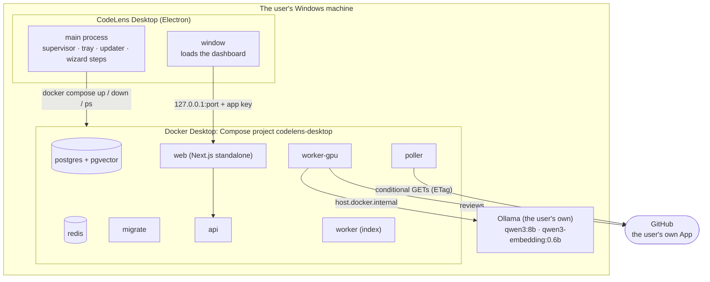
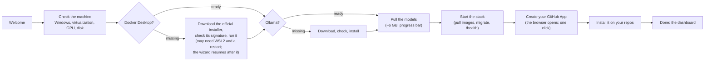

# CodeLens v2: Engineering Plan

> **How this relates to the other documents:** v1 is finished. Its plan of record,
> [`planning.md`](planning.md), is kept as the record of how v1 was built (Phases 1–9,
> decisions D1–D137, questions Q1–Q20) and no longer changes. **This file is the plan of
> record for v2.** It adds Phases 10 and up, decisions D138 and up, and questions Q21 and up.
> Where the two disagree, this file wins. [`idea.md`](idea.md) is still the design
> narrative, and [`architecture.md`](architecture.md) still describes what is built (it
> changes as v2 lands).

**Last updated:** 2026-10-17 · **Current position:** Phase 10 is done (#58–#70, plus the fix #67, D163). Phase 11 has started: step 1 is split in two, and local mode (step 3) is pulled into the first half (the user's choices, 2026-10-17). Step 1a, the stack the app runs, is merged (#72). Step 1b, the Electron spike, is in review, and its answer is **go** (the spike report below §6's Phase 11 table). **Next:** step 2, GitHub polling.

---

## Contents

0. [Summary](#0-summary)
1. [Where v1 ended](#1-where-v1-ended)
2. [Two products, one codebase](#2-two-products-one-codebase)
3. [Independent for whoever downloads it](#3-independent-for-whoever-downloads-it)
4. [The desktop app's architecture](#4-the-desktop-apps-architecture)
5. [The UI upgrade](#5-the-ui-upgrade)
6. [Build phases](#6-build-phases)
7. [Decisions](#7-decisions)
8. [Risks](#8-risks)
9. [Open questions](#9-open-questions)
10. [Conventions and definition of done](#10-conventions-and-definition-of-done)

---

## 0. Summary

v1 is an AI code reviewer for GitHub pull requests that runs on its owner's GPU: a code
graph, a local `qwen3:8b`, inline comments on the PR, and a dashboard that explains every
review. It is used two ways today: the public read-only demo, and a fresh clone set up with
`codelens doctor` and `codelens setup`.

**v2 has two goals:**

1. **A better UI** (Phase 10): a real design system, a bolder CodeLens brand, an app shell,
   an overview page, and a review page that puts the findings first. It ships to the
   public demo and to everyone running CodeLens.
2. **A downloadable desktop app** (Phase 11): **CodeLens Desktop**, a Windows installer.
   Someone downloads it, runs it, and a first-run wizard sets up everything else: Docker
   Desktop, Ollama, the models, the database, their own GitHub App. No terminal, no clone,
   no `.env` to edit.

Both are kept: **the web** (the hosted demo, and the clone-and-run setup for developers)
and **the software** (the desktop app). They share one codebase (§2). And whoever
downloads the software depends on nothing of the owner's: not the laptop, not the GitHub
App, not the demo, not any server (§3).

| Concern | v2 choice | Decision |
|---|---|---|
| UI components | shadcn/ui copied into the repo (Radix primitives), lucide icons | D140 |
| Look | A bolder CodeLens brand: accent color, logo mark, type, a little motion | D141 |
| Desktop shell | Electron | D142 |
| Database, queue, services | Docker Desktop required; the app drives its own Compose project | D143 |
| Background jobs | Redis + Celery, unchanged | D144 |
| GitHub events | Polling by default; webhooks through a relay optional | D145 |
| Models | The user's installed Ollama, or the official installer if missing | D146 |
| Dashboard sign-in (desktop) | None: the app is its single local owner | D147 |
| Platforms | Windows x64 first, unsigned; macOS and Linux later | D148 |

---

## 1. Where v1 ended

v1's definition of done (`planning.md` §19) is met: the GitHub App reviews PRs with inline
comments using local models; the dashboard shows live reviews, evidence, the call graph and
the retrieval trace; `evals/RESULTS.md` tells the measured naive → naive+ story; the demo is
live at <https://codelens.raifkarani.in>. Phase 8 made it runnable by someone else from a
fresh clone, and Phase 9 fixed every finding of the first security audit.

What v1 still asks of a new user, and what v2 removes:

| v1 asks the user to | v2 desktop |
|---|---|
| Install Git, uv, Docker Desktop and Ollama by hand | The wizard checks each one and installs Docker Desktop and Ollama if missing |
| Clone the repo, run `uv sync`, `codelens doctor`, `codelens setup` in a terminal | Double-click the installer; the wizard runs the same steps with buttons and progress bars |
| Run `pnpm dev` for the dashboard, after a separate one-time setup | The dashboard is the app's window |
| Sign in to the dashboard with GitHub, and set the App's redirect URI | No sign-in (D147) |
| Use a smee.io channel that a third party can read; lose events while the machine is off | Polling (D145): nothing goes through a third party, and the app catches up after sleep |
| Look in `docker compose logs` to see what's wrong | A System page with each service's health and logs |

v1's known gaps that v2 closes on the way: the dashboard isn't in Docker Compose
(architecture.md §15) and a failed review posts nothing; see D149 and Phase 11 step 4.

---

## 2. Two products, one codebase

```
                         packages/core · services/api · services/worker · apps/web
                                              │
            ┌─────────────────────────────────┼──────────────────────────────────┐
            ▼                                 ▼                                  ▼
   Hosted demo (web)               Self-hosted (web)                   CodeLens Desktop (software)
   Vercel + Supabase               a clone + `codelens setup`          apps/desktop: an Electron installer
   DEMO_MODE: read-only,           Docker Compose, the dashboard       drives its own Compose project;
   no sign-in, no models           in a browser, GitHub sign-in        LOCAL_MODE: no sign-in
   (unchanged since Phase 7)       (unchanged, plus the web            (new in Phase 11)
                                   container, D149)
```

- **One review engine.** The desktop app runs the same API, workers and pipeline images as
  the self-hosted stack. A review made in the desktop app is the same review, with the same
  measured F1.
- **One dashboard, three modes.** `apps/web` already has two modes (normal, `DEMO_MODE`).
  v2 adds `LOCAL_MODE` for the desktop (D147). Every Phase 10 page works in all three; the
  System and Settings pages appear only where they mean something (local mode, and, for an
  admin, the self-hosted dashboard).
- **New code lives where it belongs:** `apps/desktop/` (Electron: the shell, the
  supervisor, the wizard's native steps, packaging), `core/github/poll.py` (the poller),
  and the dashboard's new pages in `apps/web`.

---

## 3. Independent for whoever downloads it

The user's requirement (2026-10-16): the downloaded software is **independent of the owner
and the owner's services**. This is a rule every Phase 11 step is checked against (D139).

| A downloaded CodeLens Desktop never | Instead |
|---|---|
| Talks to the owner's laptop | Everything runs on the user's machine |
| Uses the owner's GitHub App | The wizard creates the user's own App from the manifest (D93), on their account |
| Uses the owner's smee channel, domain, Vercel, Supabase or Cloudflare | Polling needs no relay (D145); a relay, if wanted, is the user's own |
| Shares secrets with anyone | `API_JWT_SECRET`, the App's key and webhook secret are generated on the machine, written owner-only (D132) |
| Sends telemetry, crash reports or usage data | There is none |
| Stops working if the demo or the project's repo goes away | It needs only GitHub (for the user's own App and PRs), Docker and Ollama |

Its only outside connections:

- **GitHub**, as the user's own App: reading their repos and posting their reviews, which
  is the product.
- **Downloads it asks for:** Docker Desktop and Ollama installers from their publishers,
  the models from Ollama's registry, and the CodeLens container images (D143, D150).
- **Update checks** against the project's public GitHub Releases. They can be turned off,
  and an update is never applied without the user's yes (D151).

The software is MIT-licensed like the repo. Docker Desktop has its own terms: free for
personal use, education and small companies; larger companies need a paid plan. The
download page says so.

---

## 4. The desktop app's architecture



**What each part does:**

| Part | Role |
|---|---|
| **Electron main process** | Starts and stops the Compose project, watches its health, restarts what fails, keeps logs, shows a tray icon, starts at login if asked, checks for updates. Runs the checks that must happen before Docker exists (Windows version, virtualization, Docker, Ollama, GPU, disk) |
| **The window** | Loads the dashboard from the `web` container on a loopback port. The first run shows the wizard instead |
| **The Compose project** | The same services as today's `docker-compose.yml`, plus `web` (D149) and `poller` (D145), under their own project name, data folder and free ports, so a developer's own stack on the same machine doesn't clash |
| **Data** | `%LOCALAPPDATA%\CodeLens\`: the mirrors (`data/`), the secrets (`secrets/`, owner-only), the generated `.env`, logs, database backups. The database itself is a named Docker volume |
| **Ollama** | The user's own installation, reached at `host.docker.internal:11434` as today (D146) |

**First run (the wizard):**



Each step is idempotent and resumable, like `codelens setup` (D126): closing the app
halfway, or a restart for Docker, picks up at the first step not yet done. Once the stack
runs, the remaining checks come from `codelens doctor` inside the API container, as JSON
(a new `--json` flag), so the wizard and the terminal share one source of truth.

**Day to day:** the app lives in the tray. Closing the window doesn't stop reviews.
**Pause** stops the workers; **Quit** stops the stack. On the next start it catches up on
PRs pushed meanwhile (D145).

---

## 5. The UI upgrade

### 5.1 What's wrong today

Measured against the live demo (2026-10-16):

- The review page stacks the timeline, the changed code and the token usage **above** the
  findings and the diff, so the thing a reader came for is below the fold.
- Every page is a single centered column with a top bar: no navigation beyond
  "Repositories", no way to see reviews across repos, no home page that says what's going
  on.
- Styles are ad-hoc Tailwind classes repeated per component (zinc grays, per-file severity
  colors). Dark mode follows the system and can't be chosen.
- The diff has no syntax highlighting; the live timeline is a list of sentences; the graph
  uses React Flow's default nodes.
- There is no brand beyond the word "CodeLens".

### 5.2 Direction

- **Components:** shadcn/ui, copied into `apps/web/src/components/ui/` (D140). The code is
  ours to read and change; Radix underneath gives keyboard and screen-reader behavior for
  dialogs, drawers, menus, tooltips and tabs. Plus `lucide-react` (icons), `sonner`
  (toasts), `cmdk` (the command palette) and Shiki (syntax highlighting, run on the
  server so no highlighter ships to the browser).
- **Brand (D141):** an accent color, a logo mark, a type scale and a few motion rules,
  chosen by the user from 2–3 options in step 1, defined once as CSS variables for light
  and dark. Severity colors stay distinct from the accent, so "critical" never looks like
  a button.
- **Tokens, not classes:** colors, radii, shadows and spacing come from the theme; pages
  use names (`bg-surface`, `text-muted`, `severity-critical`), not raw palette values.
- **Same data, same API:** apart from the overview (step 3), Phase 10 changes how things
  look and move, not what the API returns.

---

## 6. Build phases

Each phase is a series of numbered steps, one PR each, with a stop for review after each
(as in v1, `planning.md` §9). A step is done when its exit criteria hold, CI is green, and
the docs say what changed.

### Phase 10: UI upgrade

**Exit:** every existing page rebuilt on the shared design system and brand, the overview
and the cross-repo reviews list added, the demo live with the new UI, tests green, README
screenshots refreshed.

| Step | Deliverable | Exit criteria | User action |
|---|---|---|---|
| 0 ✅ #58 | **This plan:** `planning-v2.md`; `planning.md` frozen as the v1 record (its Phase 9 status corrected); README, `idea.md`, `architecture.md` and `docs/` point to v2 | Docs only | Review the plan |
| 1 ✅ #59 | **Brand and design foundation:** 2–3 brand options (accent, logo mark, type) shown as a page; the chosen one as tokens for light and dark; shadcn/ui set up; the primitives (button, badge, card, tabs, tooltip, sheet, dialog, dropdown, toast, skeleton, empty state, kbd); a theme toggle (system, light, dark); the existing components (`badges`, `tabs`, `pager`, `skeleton`) moved onto them | No page looks broken in either theme; vitest, lint and build green | Pick the brand |
| 2 ✅ #60 | **App shell:** a collapsible sidebar (Overview, Repositories, Reviews; System and Settings slots for later), breadcrumbs, the user menu, the demo banner restyled, a ⌘K command palette (go to a repo or a review, switch theme); a sheet sidebar on phones | Every page reachable from the sidebar and the palette; keyboard only works. *As built:* the sidebar lists Repositories and your repos; Overview and Reviews join it in step 3, with their pages | — |
| 3 ✅ #61 | **Overview and cross-repo reviews:** `/` becomes an overview (stat tiles: reviews this week, findings by severity, median time to post, repos by status; recent reviews; what's running now); `/reviews` lists every visible repo's reviews with status and severity filters. API: `GET /api/v1/reviews` (keyset, across the caller's visible repos) and `GET /api/v1/stats`, with access tests (D111) | New endpoints tested for access and pagination; the demo's overview renders from its data. *As built:* eval runs are left out of both unless asked for (D155); the overview's chart follows the dataviz rules with a chart color validated per mode (D156); the reviews table folds "Took" into "When" so it fits beside the sidebar, and the repo's own name outlasts its owner when the column is narrow | — |
| 4 ✅ #63 | **The review page:** findings first. A header with the PR, status and severity summary; a file tree with finding counts; the diff highlighted by Shiki; a findings panel with severity and category filters; keyboard navigation (`j`/`k` next/previous finding, `e` evidence, `g` graph); the evidence in a side sheet, highlighted; run details (timeline, changed code, tokens) in a collapsible panel | A finding is visible without scrolling on a 1366×768 screen; every finding reachable by keyboard. *As built:* measured at 1366×768 with the demo notice showing: the first finding in the panel at y=405 and its card in the diff at y=602; filters narrow the panel and the diff together; `j`/`k` move and focus the card, `e` opens its first evidence, `g` its graph; the evidence sheet hands focus back on close (D158) | — |
| 5 ✅ #64 | **Live progress:** a running review shows a stepper (changes → context → generating chunk *i* of *n* → validated → posted) driven by the existing SSE events, with elapsed time; a toast when it ends; repo and review lists update their status live | Watched live on a real PR. *As built:* watched live on 2026-10-17: playground PR #4 reopened (its branch restored, then deleted again), review #1388 queued ~4 s later, the stepper went Changes → Context → Review chunk 1 of 1 → finished in 38 s, and the page turned into its 4 findings. The run exposed a replayed stream repeating events, fixed by dropping repeats by event id across subscriptions (D159). Lists already re-render every 3 s while something runs (v1's AutoRefresh) | Allow a test push |
| 6 ✅ #65 | **Graph and trace:** custom React Flow nodes (kind icon, change color, seen or not, ★ evidence), a legend, a minimap, hover-highlighting a node's neighbours, code in the side sheet; trace budget bars, a sortable and filterable candidate table | Same data as today, nothing lost; graph-layout tests still pass. *As built:* the graph's 32 nodes on review #1386 each describe themselves to screen readers; the minimap draws all of them (it needed `initialWidth`/`initialHeight` on controlled nodes); a real Enter on a focused node opens its code and Escape returns focus to it (handled in the capture phase, D160); the trace is one table per chunk with a "For" column instead of one table per changed code, so all 32 candidates and what each was found for are still there | — |
| 7 ✅ #66 | **Repo pages and the states between:** index stats as cards, run history, re-index with a toast; empty states that say what to do (no repos → install the App); 404 and error pages in the new style | Every empty and error state seen at least once. *As built:* each was seen in the browser on 2026-10-17, against a second local API: no repositories and no reviews (a visitor with no access), no reviews with a status (`?status=`), no older index runs (`?cursor=`), never indexed and no reviews for a repo (two throwaway rows, deleted after), no graph and nothing retrieved (failed review #690), no diff stored (#691), not found (`/repos/99999`, `/reviews/abc`, an unknown path), and the error page (the API stopped; Try again recovered once it was back). Re-index showed both toasts: queued, and refused (`not_indexable`) with the reason kept under the button. A pending repo's button now says Queued… rather than Indexing… (D161) | — |
| 8 ✅ #68 | **Checks:** an accessibility pass (focus, contrast, reduced motion, labels), phone and tablet layouts, Playwright smoke and screenshot tests against the demo export, README screenshots and launch-video stills refreshed, the demo redeployed | Playwright in CI; the live demo shows the new UI. *As built:* a CI job `e2e` runs in Playwright's Linux image: Postgres loaded with the demo export (`apps/web/e2e/fixtures`, via `scripts/e2e_data.py`, which migrates to the export's revision, imports, then migrates to head), the API in demo mode, the dashboard built for production, then 79 tests: smoke (every page, j/k, the graph's Enter and Escape, sorting, the palette, the theme, a 404), axe's WCAG 2.2 AA rules on 10 pages in both themes, visible focus, reduced motion, no sideways scroll and tap targets on desktop, tablet and phone, and 12 stored screenshots. The first run found and this step fixed: `--added`/`--deleted` too light for small text on their tints, code tokens under 4.5:1 on diff rows (now GitHub's `-default` themes, each colour nudged until it passes), GitHub links in review rows too small to tap, screen-reader text widening a phone's page out of a table's scroll box, animations ignoring reduced motion, and a lower-case "what retrieval found". The live demo already shows the new UI: Vercel deploys `main`. The launch video was re-rendered in the new UI afterwards, in its own PR (#70, the user's choice) | — |

### Phase 11: CodeLens Desktop (Windows)

**Exit:** on a Windows machine that has never seen CodeLens, a user downloads the
installer, follows the wizard, and gets a review posted on their own PR by their own App,
without a terminal, and without anything of the owner's involved (§3).

| Step | Deliverable | Exit criteria | User action |
|---|---|---|---|
| 1a ✅ #72 | **The stack the app runs.** Step 1 split in two, and local mode (step 3) pulled into this half: the user's choices (2026-10-17). The dashboard as a `web` container (D164); local mode in the API and the dashboard (D165); the Compose project `codelens-desktop` and its driver, `apps/desktop/src/stack.ts`, with a development CLI (D166); CI building the three images and publishing them to GitHub's registry from `main`, pinned by digest (D167) | The project starts from built images and every service is healthy; the dashboard answers only a loopback Host carrying the launch's key (tests, and the running container); the images build in CI. *As built:* built from this checkout, the project was healthy in 42 s (34 s with images cached) and stopped in 3.7 s; idle, its six containers used ~495 MiB. Against the running container: no key, a wrong key, the previous launch's key, or the right key with `Host: evil.example` all got 403, including `/api/palette` and `/api/nodes/1.svg`; with the key every page rendered; Re-index went through a Server Action to the API (as the owner) and the worker; only the dashboard had a port. The step's security review probed a production build of the gate with unusual paths (traversal and encoded `/_next/static/` prefixes, `.rsc` and `_next/data` forms, the image optimizer, absolute-form targets, a forged Host): nothing reached a page, route handler or the API without the key, and nothing was found above its bar. Left for 1b: a stopped container keeps its last key in its configuration, so the app must recreate `web` with a new key on every start (which `up` does) | Make the three packages on GitHub public after the first publish (done: anonymous pulls work) |
| 1b | **Spike, then go/no-go:** `apps/desktop` (Electron) starts the stack through 1a's driver with the images pinned in `images.json`, sets the launch's key as a cookie in its window, shows the dashboard, and stops the stack cleanly on quit. Measured: installer size, time to a running stack (first pull, and warm), idle RAM with the app | A short report with the numbers; go or no-go recorded here. *As built:* the report below; **go** (D168). The user's own run of the installer (2026-10-17): SmartScreen's Run anyway, then the dashboard 20.6 s after launch; uninstalled afterwards (the uninstaller closed the app while it stopped the stack: the stack stopped, but the app's last log line was never written, so step 7's uninstaller should stop the stack itself) | Run the spike build once (done) |
| 2 | **GitHub polling** (`core/github/poll.py`, a `poller` service, D145): per installation, the open PRs and the default branch's head, with conditional requests; changes go through the same intake as webhooks (shared functions, so allowlist, cap, supersede and dedupe rules are identical); catch-up on start. Webhooks stay, and the relay becomes a setting | Tests replay a PR opened, pushed, reopened and the default branch moving, each producing exactly one job; the webhook tests still pass | — |
| 3 → 1a | ~~**Local mode**~~ (`LOCAL_MODE`, D147): built in step 1a instead (D165), with its tests and the step's security review | Requests from a browser tab, another Host, or without the key are refused (tests) | — |
| 4 | **Supervisor and tray:** start order and health (Docker running → stack up → `/health`), restart with backoff, logs per service in the data folder, clean shutdown, one instance only, tray (open, pause, quit), start at login (asked once); clear screens when Docker or Ollama stops. A failed review now says so on the PR (closing a v1 gap) | Killing a container, Docker or Ollama mid-run recovers or explains itself | — |
| 5 | **First-run wizard** (§4): the native checks; Docker Desktop and Ollama downloaded from their publishers and checked by signature before running (D150), with the restart Docker may need survived; the models pulled with progress; the stack started; the user's App created by the existing manifest flow (D93, D132) with the browser opened by the app; the install link; `codelens doctor --json` for the rest | Run on a machine with nothing installed and on one with everything; both end at the dashboard | — |
| 6 | **Settings and System pages** (local mode): models (installed, pulled, a button that applies the 16k-window settings to the user's Ollama after asking, D146), the App (install link, allowed accounts, review cap), events (polling interval, or a relay), repos, storage (disk used, clear mirrors), each service's health and logs, open the data folder | Every setting round-trips and survives a restart | — |
| 7 | **Packaging and updates:** an NSIS installer for Windows x64 built in CI on a version tag, published to GitHub Releases; unsigned (D148), with a download page explaining SmartScreen's "Run anyway"; update checks against Releases, applied only on the user's yes, with a database backup before new migrations (D151); an uninstaller that asks whether to delete the data and links to deleting the App | Install, update from the previous version, and uninstall all work on a clean VM | Create the first release tag |
| 8 | **Fresh-machine rehearsal:** a Windows machine (or VM with a GPU) that has never seen CodeLens, from the download page to a posted review, timed, with every confusing moment fixed; `docs/desktop.md` (the user's guide) | The exit criterion above, met and recorded | Do the rehearsal with a throwaway App |

**Step 1 spike report (2026-10-17): go.** Measured on the development laptop (i7-13650HX,
RTX 4060, Docker Desktop with an 8 GB VM), with the images CI published from `main` at
`902024f` and the app built by `pnpm dist`, run with `CODELENS_MEASURE=1`:

| What | Number |
|---|---|
| Installer (`CodeLens-Setup-0.1.0.exe`, NSIS, unsigned) | 106 MiB; 367 MiB once installed |
| What a new machine downloads for the stack | at most 494 MiB compressed: the API 104, the worker 125, the dashboard 99, Postgres 152, Redis 15 (the API and worker share base layers). The models (~6 GB) are separate |
| Launch to dashboard, first start (CodeLens's three images pulled; Postgres and Redis already cached) | 51.9 s, of which `docker compose up --wait` 50.4 s |
| Launch to dashboard, warm | 19.7–19.9 s (the stack 18.8–19.1 s), the installed build and the development one alike |
| Idle, a minute after the dashboard showed | 742–827 MiB: the app's own processes 341–351 MiB, the six containers 400–476 MiB (worker 135, API 84, GPU worker 91, dashboard 59–111, Postgres 27–50, Redis 4–5). Docker Desktop's VM and Ollama are on top |
| Quit to stack stopped | 3.4–3.8 s |

Every run loaded the dashboard through local mode's gate (the page's title was its
Overview). **Why go:** the installer is small next to the models, a warm start is under
20 s, and the stack's memory is what the Compose stack always used; Electron's ~350 MiB
is the one new cost, and acceptable on a machine that runs an 8B model. Nothing found
needs a change of D142–D149. **What the spike didn't measure:** a machine with nothing
on it (Postgres and Redis were cached, Docker Desktop and Ollama installed); that is
step 8's rehearsal. Still the largest risk (§8): installing Docker Desktop. **Found while cleaning up:** the
database volume outlives the data folder, and Postgres keeps the password it was first
started with, so deleting only `%LOCALAPPDATA%\CodeLens` leaves a volume the next
install's new password can't open. The uninstaller (step 7) must remove both or
neither, and the supervisor (step 4) must say so plainly if it happens.

### Later (not planned yet)

macOS (Apple silicon, signed and notarized) and Linux builds · code signing for Windows ·
the hosted service (`docs/hosted-service.md`) · the deferred retrieval upgrades U1–U5,
waiting for a model that uses context (`planning.md` Q2).

---

## 7. Decisions

Numbered after v1's (D1–D137 in `planning.md` §16 and `idea.md` §15).

| # | Decision | Alternatives | Why |
|---|---|---|---|
| D138 | v2 is two products on one codebase: the web (the hosted demo and the clone-and-run setup, both kept) and the desktop app; `planning-v2.md` is the plan of record, and `planning.md` is frozen as v1's record | Replace the web setup with the desktop app; keep extending `planning.md` | The user wants both (2026-10-16). One engine means one measured F1 and one set of tests for every product. A new file keeps v1's story readable as it was, and v2's decisions start from a clean page |
| D139 | Whoever downloads the software depends on nothing of the owner's: own App, own secrets, own data and models, no relay of the owner's, no telemetry; outside connections are GitHub, the downloads the user approves, and opt-out update checks (§3) | Ship with the owner's App preinstalled; a hosted relay run by the project | The user's requirement (2026-10-16). The owner's laptop or accounts would become a single point of failure, a privacy problem (strangers' code passing through them) and a cost. Phase 8 already proved a user can have their own App in one click |
| D140 | UI built on shadcn/ui copied into the repo, with Radix primitives, lucide icons, sonner, cmdk and Shiki on the server | Hand-rolled Tailwind components (today); a component library installed as a dependency (MUI, Chakra) | User's choice (2026-10-16). Copied components are code we own and can explain, like the rest of the project, while Radix handles the accessibility details (focus traps, keyboard, ARIA) that hand-rolled dialogs and menus usually get wrong. Server-side Shiki highlights without shipping a highlighter to the browser |
| D141 | A bolder CodeLens brand: accent color, logo mark, type scale and motion rules, picked by the user from 2–3 options, as tokens for light and dark; severity colors kept apart from the accent. **Chosen 2026-10-16: A, Aperture** (violet `#6e56cf` / `#9d8cf5` in dark, Geist, a lens with a three-node graph inside, soft corners), over B (fuchsia, Bricolage Grotesque) and C (lime on ink, monospace) | Polish the current neutral look | User's choice (2026-10-16): the project is a portfolio piece and should be recognisable. Choosing from options keeps the decision with the user; tokens make the brand one file to change |
| D142 | The desktop shell is Electron (`apps/desktop`) | Tauri; a tray program that opens the user's browser | User's choice (2026-10-16). The dashboard needs a Node server (Server Components, route handlers, Server Actions), and Electron ships Node; its installer, update and tray tooling is mature. Tauri would add Rust and still need a Node sidecar. A plain browser tab on localhost is harder to protect (D147). Size (~120 MB) is small next to the ~6 GB of models. Reverses D124's "not a desktop app": that choice was about Phase 8's scope |
| D143 | Docker Desktop is required; the app runs the stack as a Compose project of its own (name, free loopback ports, data folder), from images built in CI and pinned by digest, with a local build as the fallback | Bundle a native Postgres + pgvector, Redis and Python; SQLite + sqlite-vec | User's choice (2026-10-16). The stack and its tests stay exactly as measured, and packaging stays packaging, not a port to new runtimes. Cost, said plainly on the download page: Docker Desktop is a large install, may need WSL2 and a restart on Windows, and has its own license terms. Pinned digests mean an install runs exactly the images CI tested |
| D144 | Background jobs stay on Redis + Celery | A job queue in Postgres (SKIP LOCKED, LISTEN/NOTIFY) | User's choice (2026-10-16). With Docker, Redis is one more container; the job code (chains, retries, time limits, late acks, D88–D91, D107, D131) is tested and measured, and rewriting it would add risk without a desktop benefit |
| D145 | The desktop app learns about PRs and pushes by polling GitHub (conditional requests with ETags, every 30–60 s per installation, plus a catch-up on start); webhooks through a relay stay available as a setting; both feed one shared intake | smee only (v1); both offered in the wizard | User's choice (2026-10-16). Polling needs no third party (smee and anyone with its URL see every delivery, D137) and loses nothing while the machine sleeps, where webhooks to a stopped machine are lost. A shared intake means allowlist, cap, supersede and dedupe rules can't drift between the two. Cost: a review may start up to a minute later |
| D146 | Use the Ollama the user has; if there is none, download Ollama's official installer, check its signature and run it with the user's consent. The 16k-window settings are an opt-in button | Run a private copy of Ollama on its own port | User's choice (2026-10-16). One Ollama per machine: no second copy of the models on disk, no two servers fighting over VRAM, and the user's own settings stay theirs. The default stays the 8k window, which works with no server settings (D66) |
| D147 | `LOCAL_MODE`: the desktop dashboard has no sign-in and acts as the machine's one owner (an admin, as the demo acts as one anonymous visitor, D117); its web server answers only requests with a loopback Host carrying the app's key, a cookie only the app's window holds; the secrets are generated per install | GitHub sign-in as on the web (D113) | User's choice (2026-10-16). The app is single-user; a sign-in would add a browser round trip on every start and a redirect URI to configure. Loopback alone isn't enough, because any local program or web page can reach 127.0.0.1 (the lesson of D132); the key and the Host check close that |
| D148 | The first release is Windows x64 only, unsigned; macOS and Linux later | Windows signed from the start; Windows and macOS together | User's choice (2026-10-16). Windows is where everything was measured (the RTX 4060). Unsigned is free, and SmartScreen's warning can be explained; signing can be added later without other changes. macOS can't ship unsigned (Gatekeeper), so it needs the paid Apple account and a Mac to test on |
| D149 | The dashboard joins Docker Compose as a `web` container (Next.js `output: 'standalone'`), used by the desktop app and available to the self-hosted setup | Electron runs the Next server itself | One image set for every product, the same way the API and workers are shipped, and it closes v1's gap that the dashboard ran only with `pnpm dev` (architecture.md §15). Electron then only supervises and displays |
| D150 | Everything the installer downloads is checked before use: Docker Desktop's and Ollama's installers by their Windows signature (the expected publisher), CodeLens images by pinned digest, models by Ollama's own digests; nothing runs from a "latest" URL unchecked | Trust the HTTPS download | The security posture v1 kept (hash-pinned grammars, D31; secrets owner-only, D132) carries to the installer: a hijacked download or a swapped image must fail, not run. Publisher installers change with every version, so their signature is what can be pinned |
| D151 | Updates come from the project's public GitHub Releases: checked on start (can be turned off), applied only after the user agrees, with a database backup before new migrations run | Silent auto-update; no updates | A silent update would run new code on someone's machine without asking, against D139. With no updates at all, security fixes never reach users. The backup makes a bad migration recoverable, since migrations are never edited once applied (D29) |
| D152 | The theme (system, light or dark) is stored in `localStorage` and applied by an inline script in `<head>` before the first paint, as a `data-theme` attribute on `<html>`; a small hook (`lib/use-theme.ts`) keeps it applied (the system's changes, other tabs, React's development remount) | `next-themes` (which shadcn's toast component pulls in); a cookie read by the server; a `dark` class | Next 16's own guide (preventing flash before hydration) recommends the inline script: a cookie read in the root layout would make every page request-bound under Cache Components, and the build confirms every shell is still prerendered. An attribute leaves `className`, which React manages (the font variables), alone. It's about 60 lines we can explain and test (the script is run against a fake browser in `test/theme.test.ts`), where `next-themes` would be one more dependency for the same thing |
| D153 | shadcn/ui's CLI is a tool, not a dependency: the few CSS variants its components need (`data-open:` and friends) are copied into `globals.css`, `shadcn` and `next-themes` are removed from `package.json`, and the lockfile adds only the new packages (Radix and its helpers; no existing package changes version) | Keep `@import "shadcn/tailwind.css"` and the CLI as a runtime dependency (what `init` does) | The CLI and its ~300 packages would be installed on every build, for one CSS file. `components.json` stays, so `npx shadcn@latest add <name>` still works; `docs/development.md` says what to undo after it |
| D154 | The app shell: one sidebar component rendered twice (the desktop rail and the phone's sheet), its repo list fetched once per request (`React.cache`); collapsing remembered like the theme (localStorage, the same inline script, a desktop-only `collapsed:` variant); breadcrumbs from the layouts that already load the repo and the review; the ⌘K palette's data from a session-checked `/api/palette`, fetched the first time it opens | shadcn's `sidebar` block (a cookie read by the server for its state, ~700 lines); a cookie for the collapsed state; breadcrumbs from the URL alone; palette data in every page's HTML | A server-read cookie would make every page request-bound under Cache Components (D152's reason again), and the build shows every shell still prerendered. The layouts already have the names the breadcrumbs need. Loading the palette's data on first open costs pages nothing; until step 3 adds a cross-repo reviews endpoint, it asks for the latest reviews of the 8 most recently reviewed repos |
| D155 | The cross-repo review list and the overview's stats leave eval runs out unless asked for (`include_eval=true`; the Reviews page's "Show eval runs"); an eval repo's own page still lists them | Count every review; a separate eval dashboard | An eval run is a measurement: hundreds of reviews per run, which would turn "reviews this week" into "eval runs this week" (the dev database's 7 days: 27 real reviews). They stay one click away, and `evals/RESULTS.md` is where they are read |
| D156 | The overview: a row of four stat tiles (reviews, findings posted, median time from queued to finished, repositories ready), then one column chart of reviews per UTC day, built to the dataviz rules: bars at most 24px with a 4px rounded top, a hairline baseline and one peak gridline, a tooltip on hover and on keyboard focus, and a screen-reader table with the same numbers. Its fill is a `--chart-1` token: the brand violet in light, and in dark one validated step darker (`#8b78ee`) because `--primary`'s dark value (`#9d8cf5`, L 0.70) fails the dark lightness band | A chart library (Recharts); `--primary` as the fill in both modes; sparklines inside the tiles as well as the chart | Seven bars and four numbers need no library: HTML columns with Radix tooltips are a few dozen lines and theme from the same tokens. The validator (run, not eyeballed) is why the chart's color differs from the button's in dark mode; the brand itself is unchanged. One chart says the trend once, where a sparkline per tile would say it twice |
| D157 | `GET /stats` takes `anchor=latest`: the window ends on the newest review's UTC day instead of today, and says where it ends (`ends_on`, `ends_today`). The dashboard asks for it only in demo mode; the overview's subtitle then names the day, and the chart says "Today" only when it is today | Pick the anchor from `DEMO_MODE` inside the API; a longer window on the demo; re-review the demo repo every week | The demo's reviews are made on the laptop and copied (D116), so a week after publishing, "the last 7 days" would be empty for every visitor. An explicit parameter keeps the API's answer the same for the same question in every mode, and is testable; a longer window only delays the problem; re-reviewing costs GPU time for nothing new |
| D158 | The review page leads with a findings panel (severity and category filters, `j`/`k`/`e`/`g`, the changed files, the run's details folded away) beside the diff, highlighted by Shiki **on the server**: each hunk's old and new sides highlighted separately and mapped back line by line, both themes' colours on every token as CSS variables; plain text past 200k characters. The evidence sheet's code is highlighted by the route that serves it, and the sheet returns focus to wherever it was opened from | Shiki in the browser; highlighting the hunk as one block; react-diff-view; a second fetch for highlighting | A highlighter in the browser is hundreds of kB for text the server already has; one side at a time means the grammar sees real code (a docstring changed on one side would otherwise run on into the other). Variables per token mean the theme toggle needs no re-render. The sheet opens from a key or from a button elsewhere, so it has no trigger for Radix to send focus back to: it remembers where focus was |
| D159 | One event stream per review page (`review-events.tsx`), shared by the timeline and the progress stepper; repeats are dropped by event id across every subscription the page makes, and the finish toast and refresh happen once | One `EventSource` per component; de-duplicating inside each subscription (v1) | Two streams would double the API's work and could disagree. Seen live on a real PR: a stream opened again replayed from the start, and a per-subscription check let the first three events through twice (React flagged duplicate keys), which would also have miscounted chunks. The id is the event's identity (`review_events.seq`), so keeping it across subscriptions is the rule that holds whatever reopens the stream |
| D160 | The graph and trace (Phase 10 step 6): graph nodes carry their kind, change and evidence as an icon, a word and a star, plus a full `ariaLabel`; hover or keyboard focus lights a node's neighbourhood; Enter on a node is taken in the capture phase and stopped there; the minimap gets a first size per node. The trace is one sortable, filterable table per chunk, with a "For" column, and the context budget as a meter | Let React Flow handle Enter (it selects the node); a table per changed code (v1); a chart library for the meter | Measured with a real keypress: React Flow's own Enter handling pulled focus back out of the sheet that had just opened, so it closed within 3 ms (a synthetic event didn't show it). The graph is controlled with no `onNodesChange`, so React Flow never writes measured sizes back, and its minimap skips nodes without one. One table per chunk sorts and filters across every changed code at once; the per-seed grouping survives as the "For" column and its filter |
| D161 | The states between (Phase 10 step 7): every empty and error state is one `StateMessage` (shadcn's Empty with an icon, a title, what it means and a link that does the next thing), worded for where it is: demo or not, a status filter or not, a GitHub or a local repo, a review still running, failed or old. The 404 is also what an inaccessible repo or review looks like (D111), and an unmatched path gets the title "Not found". The Indexing tab's numbers are stat tiles, with call resolution as a meter; its run history colours what was added, changed and deleted. Re-index answers with a toast, and a refusal also stays under the button; a pending repo's button says Queued… | Keep each page's dashed `<p>` (v1); one generic "Nothing here" for all of them; toasts only for Re-index | The exit criterion was to see every state, and they read better as one component that always says what to do next. Wording that depends on the case avoids advice that can't be followed: no "sign in again" on the demo, no "Re-index starts one now" beside a disabled button. A missing repo or review keeps its page's tab title: Next uses the page's static metadata when the page calls `notFound()`, and making it dynamic would cost a fetch per page for a 404 |
| D162 | Checks (Phase 10 step 8): Playwright drives the production build against the API in demo mode over the committed demo export (the data the live demo serves, from a public repo; no installation ids or paths). axe's WCAG 2.2 A/AA rules gate every page in both themes; screenshots are compared against images rendered in Playwright's Linux image, which CI runs in and a local run reaches as a remote browser (`E2E_BROWSER_WS`). Highlighted code keeps 4.5:1 by moving each theme colour towards black or white just enough (`lib/contrast.ts`); one global rule honours reduced motion | Test against the live demo API (CI breaks when it's down or its data changes); screenshots from whatever OS runs the tests; hand-picked token colours; `motion-reduce:` on each animation | Self-contained and repeatable: the tests can't be broken by the demo, and the export also exercises every migration since it was made. Fonts render differently per OS, so one image is the reference everywhere. A computed nudge keeps GitHub's palette and fixes only what fails, on every background code sits on. One rule can't miss a new animation |
| D163 | A re-index that fails before the indexer opens a run (no checkout, a path that isn't a directory, no installation, an account no longer covered, a failed fetch) is recorded by the worker's index task: a failed index run carrying the error, and the repo set `failed`. A run newer than the one the task saw at its start means the indexer got that far and recorded the end itself, so nothing is added; `IndexLocked` records nothing and retries. The dashboard treats a `pending` or `indexing` repo untouched for longer than the API's `STALE_CLAIM` (1 h) as not busy, so Re-index works again whenever the API would take the claim | Set the repo back to its previous status; mark it failed without a run; only the dashboard's staleness check | Found on 2026-10-17: a local repo whose path didn't exist stayed `pending` and its button said Queued… for good, because only the indexer set `failed`, and only once a run existed. A failed run is what the Indexing tab already shows, so the reason is where the user looks. The staleness check covers what no code path can record, a worker killed mid-run |
| D164 | The dashboard as a container (`apps/web/Dockerfile`): dependencies, build and runtime stages; Next's `output: 'standalone'` switched on by `NEXT_OUTPUT=standalone`, which only the image sets; the runtime stage holds Node, `server.js` and what it traced, run as the unprivileged `node` user. One image serves normal and local mode: what depends on the mode renders per request. The exception is the demo's notice, prerendered into the shell, so the demo stays a Vercel build | Electron runs `next start` itself (rejected in D149); `standalone` always on; an image per mode | The same way the API and workers ship (D149), without pnpm, the source or dev dependencies in the image. Vercel packages the app its own way, so the demo's build is untouched. Measured: 429 MB on disk, of which the app is 76 MB and the rest Node's base image; built in about a minute |
| D165 | Local mode, the desktop's no-sign-in dashboard (D147), built in step 1a. **API:** `LOCAL_MODE=true` makes every valid token the owner's (an admin), and refuses to start alongside `DEMO_MODE`. **Dashboard:** `src/proxy.ts` gates every path except `/_next/static/`: the Host must be a loopback name (`127.0.0.1`, `localhost` or `[::1]`, any port) and the cookie `codelens_app_key` must equal `LOCAL_APP_KEY` (both hashed, then compared in constant time); every refusal is the same 403, and a missing or short key refuses everything (503). The key is made at every launch, held in memory and passed to the container, never written to disk. The proxy also sends `/login` to `/repos`, building the address from the Host header | A per-install key in `codelens.env`; a check in each route handler; `API_ADMIN_LOGINS=local` instead of a mode; the matcher's old exclusions (`.svg`, `favicon.ico`, `/api`) | A browser tab or any local program can reach 127.0.0.1, and DNS rebinding can make a stranger's page do so under its own name: the key and the Host check close both (D132's lesson). One gate in the proxy covers pages, route handlers and Server Actions alike, and its matcher must not skip by pattern: `/api/nodes/1.svg` would have reached a route handler ungated. A mode states the API's intent, where an admin login named `local` would be a coincidence. Two things found running it: the login page's own redirect is prerendered when the image is built, so the proxy redirects instead; and Next spells `127.0.0.1` as `localhost` in `request.url`, which would carry the window to a host its cookie doesn't belong to |
| D166 | The desktop's Compose project (`apps/desktop/compose.yaml`, name `codelens-desktop`): only the dashboard is published, on `127.0.0.1` at a free port chosen per launch; the API, Postgres and Redis have no host ports. Each install generates its own Postgres password and API secret (`codelens.env` in `%LOCALAPPDATA%\CodeLens`). Third-party images are pinned by digest like ours. Quitting stops the containers (`stop`, not `down`), so the next start is quick and the data stays. `src/stack.ts` is plain functions over Node's standard library, shared by the development CLI and, next, the Electron app | Reuse `docker-compose.yml` with an override; publish the API and database ports as the dev stack does; fixed ports | Nothing is reachable that doesn't need to be, and a developer's own stack on the same machine never clashes (5433, 6379 and 8000 stay free). Measured on this laptop: healthy 34–42 s after `up` from built images, stopped in 3.7 s, ~495 MiB idle across six containers (worker 155, API 104, GPU worker 91, dashboard 82, Postgres 57, Redis 5) |
| D167 | CodeLens's three images (api, worker, web) are built by CI (`.github/workflows/images.yml`, linux/amd64): on pull requests that touch them, without pushing; from `main`, published to `ghcr.io/raif-karani/codelens-{api,worker,web}`, tagged `sha-<commit>` and `main`. The run's summary gives each digest for `apps/desktop/images.json`, and the driver refuses an entry that isn't `name@sha256:<64 hex>` | Build on the user's machine (kept only as the developer's fallback, `compose.build.yaml`); Docker Hub; pinning tags | The user's choice (2026-10-17). GitHub's registry sits next to the repo, is free for public images, and the workflow's own token can push. A digest names exactly the bytes CI built and tested (D150); a tag can be moved. Cost: GitHub makes a new package private, so each must be made public once by hand |
| D168 | The desktop shell, as the spike built it (`apps/desktop/src/main.ts`): one window on its own persistent session (`persist:codelens`), sandboxed, with context isolation and no Node in the page; the launch's key set as a session cookie (no expiry; httpOnly; SameSite=Strict) for exactly `http://127.0.0.1:<port>`; navigation inside the window only to that origin, and only `https:` links handed to the user's browser; every permission request refused; one instance at a time; quitting stops the stack (`stop`, D166) before the app exits. Installed, `compose.yaml` and `images.json` ship in `resources/`, outside the app's archive, because docker reads them as files. Electron 44.5.1 and electron-builder 26.15.3 are pinned exactly, each released weeks before use. **Spike answer: go** (the report under §6's Phase 11) | A preload script and IPC for the start-up screen; an in-memory session; Electron's newest release (44.9.0, out the same day) | The key cookie is the dashboard's whole authorization (D165), so the window must never load anything else, and the browser keeps what it would open. A data: page needs no preload: the main process swaps the page itself. A persistent session keeps the dashboard's theme between launches; the key can't outlive its launch anyway, since the next one brings a new key and recreates the container. A version only hours old has had no time to have problems found |

---

## 8. Risks

| Risk | Likelihood | Impact | Mitigation |
|---|---|---|---|
| Docker Desktop is too much for non-developers (WSL2, a restart, its size, its license) | High | High | The wizard explains each step before it happens and resumes after the restart; the download page states the requirement up front. If the rehearsal shows it's the main obstacle, revisit D143 |
| Docker Desktop's startup bug on Windows Insider builds (`planning.md` §1.5) | Medium | Medium | The supervisor detects "Docker installed, not running" and shows the documented fix |
| Unsigned installer flagged by SmartScreen or antivirus (an app that starts other processes) | High | Medium | The download page shows the "Run anyway" path; signing is the first item under "Later" |
| GitHub rate limits from polling many repos | Low | Medium | Conditional requests; one installation-level repo list; the interval grows with repo count; measured in step 2 (Q22) |
| GPU shared with games or too small; CPU-only machines | High | Medium | The wizard reports the GPU before the 6 GB download; reviews still run on CPU, slowly; a smaller model is a question for the evals (Q23) |
| The user's Ollama on another port, or a version without structured outputs | Medium | Medium | The wizard finds and checks it (version and `/api/version`), and Settings lets the URL change (Q24) |
| Docker Desktop alternatives (Rancher Desktop, Podman) | Medium | Low | Detected and called unsupported in v2 (Q25) |
| A Next.js standalone build that misses files in the monorepo | Medium | Low | The spike (Phase 11 step 1) builds and runs it; `outputFileTracingRoot` as the Next docs describe |
| The brand pass grows into a redesign of everything | Medium | Medium | Step 1 fixes tokens and primitives only; each later step owns its pages |

---

## 9. Open questions

| # | Question | Decide by |
|---|---|---|
| Q21 | ~~Which brand?~~ **Answered 2026-10-16: A, Aperture** (user's choice from three options; D141). Was: which brand: accent color, logo mark, type? | Phase 10 step 1 (2–3 options shown) |
| Q22 | Polling interval and how it scales with the number of repos; does GitHub count 304 answers against the rate limit for App installation tokens? | Phase 11 step 2 (measure) |
| Q23 | Offer a smaller model (e.g. `qwen3:4b`) for GPUs under 8 GB? It would need its own eval run before it's offered, since the F1 0.767 is `qwen3:8b`'s | After Phase 11, with the eval harness |
| Q24 | Support an Ollama on another machine (a home server)? | Phase 11 step 6 |
| Q25 | Support Rancher Desktop or Podman instead of Docker Desktop? | After the rehearsal |
| Q26 | Should "start at login" default to on? | Phase 11 step 4 |

---

## 10. Conventions and definition of done

Unchanged from v1 (`planning.md` §19), with v2's numbering:

- **Branches:** `phase-N/step-M-short-name`; conventional commits; one PR per step; stop
  for review after each.
- **Docs:** this file's status line and §6 checkmarks are updated as steps land; new
  decisions are added to §7 with their alternatives and reasons; `architecture.md` changes
  in the same PR as the components it describes.
- **Code:** the dashboard's `AGENTS.md` applies: Next.js 16 differs from older versions, so
  read the guide in `node_modules/next/dist/docs/` before writing Next code.
- **A step is done when** the code and tests are merged, CI is green, docs are updated,
  there's a "what I built / how to run it / what to verify" note, and the user has
  reviewed it.

**v2 is done when:**

1. The dashboard runs on the new design system and brand everywhere: the demo, the
   self-hosted web and the desktop app.
2. A Windows user with nothing installed goes from the download page to a review on their
   own PR by their own App, through the wizard alone.
3. Nothing in that path touches the owner's laptop, App, relay or services (§3).
4. The README tells both stories: try the demo on the web, or download the software.
